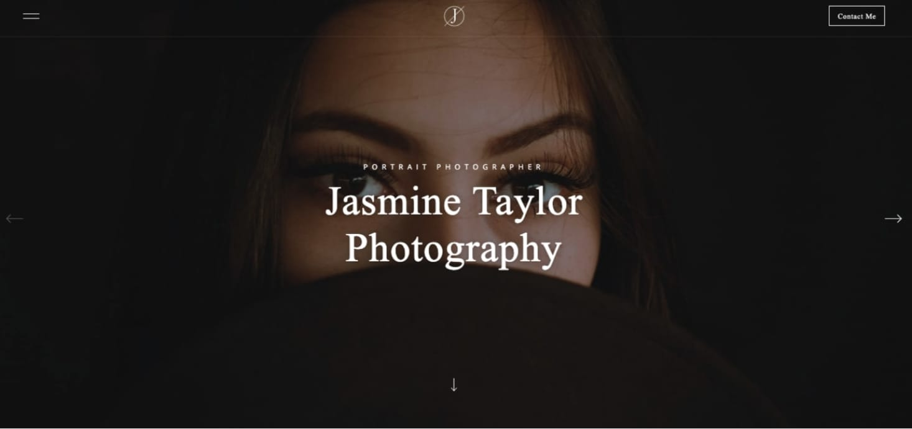

As a photographer, it’s important to get the visuals right while establishing your online presence. Having a unique and professional portfolio will make you stand out to potential clients. The only problem? Most website builders out there offer cookie-cutter options — making lots of portfolios look the same.

That’s where a platform like Webflow comes to play. With Webflow you can either design and build a website from the ground up (without writing code) or start with a template that you can customize every aspect of. From unique animations and interactions to web app-like features, you have the opportunity to make your photography portfolio site stand out from the rest.

So, we put together a few photography portfolio websites that you can use yourself — whether you want to keep them the way they are or completely customize them to your liking.

## 12 photography portfolio websites to showcase your work

Here are 12 photography portfolio templates you can use with Webflow to create your own personal platform for showing off your work.

### 1. Jasmine

